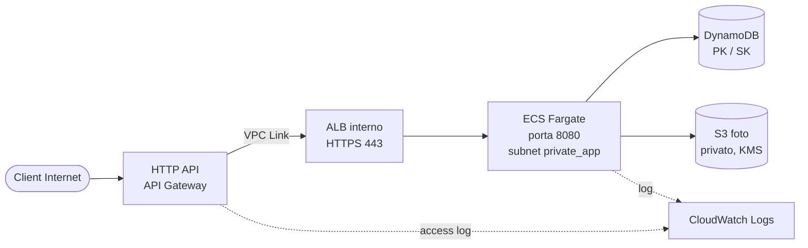
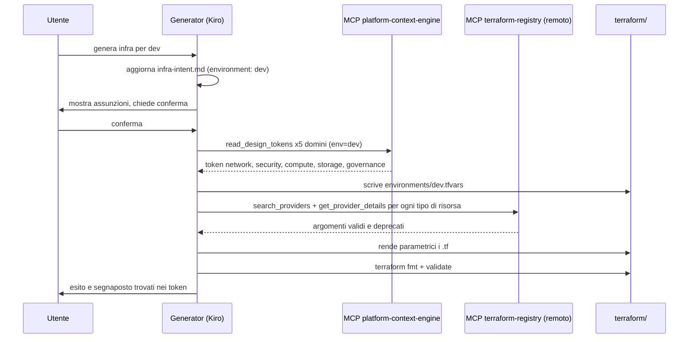

# Design Document

## Overview

Il design rende parametrico il codice Terraform esistente in `terraform/` e genera i valori dell'ambiente **dev** dai Design Tokens, senza cambiare il comportamento di prod.

Oggi `terraform/locals.tf` contiene valori di prod scritti a mano (VPC, subnet, ARN KMS, dimensionamento, tag) e alcune risorse hanno impostazioni fisse (`deletion_protection`, versioning S3, point-in-time recovery). Il design sposta tutto questo in variabili e introduce un file di valori per ambiente:

- `terraform/environments/dev.tfvars`: generato dai token di `platform/tokens/dev.yaml`.
- `terraform/environments/prod.tfvars`: ricavato dai token di `platform/tokens/prd.yaml`, con gli stessi valori oggi in `locals.tf`.

Decisioni principali:
- **Una sola configurazione, più ambienti.** I `.tf` descrivono la forma dell'infrastruttura. I `.tfvars` contengono solo i valori dei token. Il comando cambia con `-var-file`.
- **I token restano la fonte.** Il Generator legge i token tramite `read_design_tokens` e scrive il `.tfvars`. Non si copiano valori a mano.
- **Nessuna dipendenza da AWS in fase di generazione.** Il codice non usa data source per cercare VPC o subnet. I valori arrivano dai token, così `validate` funziona senza credenziali.
- **Nessun modulo esterno.** Solo risorse primitive del provider `aws ~> 5.0`, come richiesto dalle regole di Phase 1.

## Architecture



Flusso di generazione:



## Components and Interfaces

### Struttura dei file

```text
terraform/
├── versions.tf          # provider aws ~> 5.0, default_tags da variabile
├── variables.tf         # tutte le variabili (ambiente + obbligatorie)
├── locals.tf            # name_prefix, api_routes, nomi accorciati
├── s3.tf
├── dynamodb.tf
├── iam.tf
├── network.tf           # security group, ALB, target group, listener
├── ecs.tf
├── apigw.tf
├── outputs.tf
└── environments/
    ├── dev.tfvars       # nuovo, generato dai token di dev
    └── prod.tfvars      # nuovo, stessi valori di oggi
```

### Mappa token → variabile

| Token (`dev.yaml`) | Variabile Terraform | Valore dev |
| :--- | :--- | :--- |
| `environment` | `environment` | `dev` |
| `aws_region` | `aws_region` | `eu-west-1` |
| `network.vpc_id` | `vpc_id` | da token |
| `network.subnets.private_app` | `private_subnet_ids` | 2 subnet |
| `security.kms_keys.storage_key_arn` | `storage_kms_key_arn` | da token |
| `security.kms_keys.database_key_arn` | `database_kms_key_arn` | da token |
| `security.tls_policy` | `tls_policy` | `ELBSecurityPolicy-TLS13-1-2-2021-06` |
| `security.enable_deletion_protection` | `enable_deletion_protection` | `false` |
| `compute.fargate_profiles.small.cpu` | `fargate_cpu` | `256` |
| `compute.fargate_profiles.small.memory` | `fargate_memory` | `512` |
| `compute.desired_count` | `desired_count` | `1` |
| `storage.s3.force_destroy` | `s3_force_destroy` | `true` |
| `storage.s3.versioning_status` | `s3_versioning_status` | `Suspended` |
| `storage.s3.audit_log_target_bucket` | `audit_log_bucket` | `acme-dev-centralized-access-logs` |
| `storage.dynamodb.point_in_time_recovery` | `dynamodb_pitr_enabled` | `false` |
| `governance.naming_mask` | `naming_mask` | `acme-dev-{service_name}-{resource_suffix}` |
| `governance.default_tags` | `default_tags` | tag di dev |

Il profilo Fargate è `small` perché lo dichiara l'Intent_File (`compute.size`). La porta del container (8080) viene dall'intent e non dai token.

### Variabili obbligatorie senza default

`container_image`, `acm_certificate_arn`, `alb_internal_domain_name`. Non sono nei token e non entrano nei `.tfvars` generati: si passano con `-var` o con un file locale non versionato.

### Modifiche alle risorse esistenti

| File | Oggi | Dopo |
| :--- | :--- | :--- |
| `s3.tf` | `force_destroy = false`, versioning `Enabled` | `var.s3_force_destroy`, `var.s3_versioning_status` |
| `s3.tf` | bucket di audit fisso | `var.audit_log_bucket` |
| `dynamodb.tf` | PITR `true`, deletion protection `true` | `var.dynamodb_pitr_enabled`, `var.enable_deletion_protection` |
| `network.tf` | ALB `enable_deletion_protection = true` | `var.enable_deletion_protection` |
| `ecs.tf` | `local.desired_count` | `var.desired_count`, `var.fargate_cpu`, `var.fargate_memory` |
| `versions.tf` | `local.aws_region`, `local.default_tags` | `var.aws_region`, `var.default_tags` |
| `locals.tf` | costanti di prod | solo `name_prefix`, `api_routes` e nomi derivati |

### Naming

`locals.tf` ricava il prefisso dalla maschera dei token, senza riscrivere la formula:

```hcl
locals {
  service_name = "garage-management"
  name_prefix  = replace(replace(var.naming_mask, "{service_name}", local.service_name), "-{resource_suffix}", "")
}
```

I nomi di ALB e target group hanno un limite di 32 caratteri. Con `acme-prod-garage-management-alb` si arriva a 31, quindi oggi c'è poco margine. Per questo i nomi di questi due si ricavano con `substr(..., 0, 32)` e un controllo `precondition` che fallisce se il prefisso lascia meno di 3 caratteri per il suffisso.

### Differenze di comportamento tra dev e prod

| Aspetto | dev | prod |
| :--- | :--- | :--- |
| Fargate | 0.25 vCPU / 512 MB | 0.5 vCPU / 1 GB |
| Task | 1 | 2 |
| S3 versioning | sospeso | attivo |
| S3 `force_destroy` | sì | no |
| DynamoDB PITR | no | sì |
| Deletion protection (DynamoDB, ALB) | no | sì |
| KMS | chiavi condivise | CMK dedicate |

La cifratura resta sempre attiva (S3 con KMS, DynamoDB con KMS, public access block): i token di dev cambiano solo la chiave, non l'obbligo.

## Data Models

Il dato principale è il `.tfvars` generato. Esempio per dev:

```hcl
environment                = "dev"
aws_region                 = "eu-west-1"
vpc_id                     = "vpc-0111111111dev0000"
private_subnet_ids         = ["subnet-0devapp1a", "subnet-0devapp1b"]
storage_kms_key_arn        = "arn:aws:kms:eu-west-1:111122223333:key/dev-shared-storage-key"
database_kms_key_arn       = "arn:aws:kms:eu-west-1:111122223333:key/dev-shared-db-key"
tls_policy                 = "ELBSecurityPolicy-TLS13-1-2-2021-06"
enable_deletion_protection = false
fargate_cpu                = "256"
fargate_memory             = "512"
desired_count              = 1
s3_force_destroy           = true
s3_versioning_status       = "Suspended"
audit_log_bucket           = "acme-dev-centralized-access-logs"
dynamodb_pitr_enabled      = false
naming_mask                = "acme-dev-{service_name}-{resource_suffix}"
default_tags = {
  Organization = "AcmeCorp"
  Environment  = "dev"
  ManagedBy    = "Kiro-IaI"
  CostCenter   = "Fleet-Engineering-Dev"
}
```

Le variabili hanno `validation` dove il valore è vincolato: `environment` in `dev|staging|prod`, `s3_versioning_status` in `Enabled|Suspended`, `fargate_cpu` tra i valori ammessi da Fargate.

Il modello dei dati dell'applicazione (DynamoDB a tabella singola, chiavi `PK` e `SK`) non cambia. Le entità e i pattern di accesso sono responsabilità del codice dell'API e non di questa infrastruttura.

## Error Handling

| Situazione | Comportamento |
| :--- | :--- |
| `read_design_tokens` restituisce `error` | La generazione si ferma e l'errore viene mostrato all'utente (R2.2). |
| Il file token manca o manca un dominio | Si usa il messaggio del tool; non si inventano valori (R2.4). |
| La documentazione del Registry non riporta la risorsa o l'attributo | Si corregge la risorsa prima di proseguire (R3.2). |
| Il Terraform MCP server remoto non risponde (token HCP mancante o scaduto) | Ci si ferma e lo si segnala all'utente, senza usare attributi a memoria. |
| `terraform validate` fallisce | Si corregge e si rilancia finché passa (R10.2). |
| Prefisso troppo lungo per ALB o target group | La `precondition` fallisce in `plan` con un messaggio chiaro (R8.3). |
| Variabile obbligatoria mancante | Terraform si ferma e chiede il valore; nessun default (R9.3). |

## Testing Strategy

I test restano facoltativi per le regole del workspace. Il design prevede controlli leggeri, tutti senza credenziali AWS:

- **Validazione statica:** `terraform fmt -check` e `terraform validate` con `-var-file=environments/dev.tfvars` e con `prod.tfvars` (R10.1).
- **Coerenza token ↔ tfvars:** uno script Python in `tests/unit/` carica `dev.yaml` e `dev.tfvars` e verifica che ogni valore della mappa sopra coincida.
- **Assenza di costanti di ambiente:** un controllo (`grep`) verifica che nei `.tf` non compaiano ID `vpc-`, `subnet-`, ARN `arn:aws:kms` né il letterale `prod` o `dev` fuori dai `.tfvars` (R9.1).
- **Nessuna regressione su prod:** `terraform plan` con `prod.tfvars` deve produrre gli stessi attributi di prima. Richiede credenziali, quindi è un passaggio manuale.
- **Segnaposto:** il Generator segnala i valori dei token che sembrano finti, per esempio ID con `0111111111` o ARN con account `111122223333` (R10.4).

## Correctness Properties

Proprietà che devono valere per ogni ambiente generato.

### Property 1: Fedeltà ai token

Per ogni variabile nella mappa token → variabile, il valore nel `.tfvars` dell'ambiente è uguale al valore del token corrispondente.

**Validates: Requirements 2.3, 2.4, 2.5, 9.2**

### Property 2: Nessuna costante di ambiente nei `.tf`

Nessun file `.tf` contiene ID `vpc-` o `subnet-`, ARN KMS, né il letterale `dev` o `prod` come valore di ambiente. Questi valori compaiono solo nei `.tfvars`.

**Validates: Requirements 9.1**

### Property 3: Naming coerente

Ogni risorsa con nome ha un nome che inizia con il prefisso ricavato dalla `naming_mask` dell'ambiente e rispetta i limiti di lunghezza del servizio.

**Validates: Requirements 8.1, 8.3**

### Property 4: Stessa forma, valori diversi

Con `dev.tfvars` e `prod.tfvars` l'insieme dei tipi di risorsa è identico; cambiano solo i valori degli attributi.

**Validates: Requirements 9.2**

### Property 5: Isolamento e cifratura sempre attivi

In ogni ambiente il service Fargate ha `assign_public_ip = false`, il bucket ha il public access block con tutti i flag a `true`, e S3 e DynamoDB sono cifrati con la chiave KMS dell'ambiente.

**Validates: Requirements 4.2, 4.3, 5.2, 6.2**

## Rischi e punti aperti

- **Token segnaposto.** Gli ID di VPC e subnet e gli ARN KMS di dev e prod sembrano finti. `validate` passa, ma `apply` fallirebbe finché non si usano valori reali.
- **Uscita di rete dei task.** I security group permettono l'uscita sulla 443 verso `0.0.0.0/0`. In una VPC privata senza NAT servono VPC endpoint; la scelta dipende dalla tua rete e resta fuori da questo spec.
- **Autenticazione e CORS.** L'API pubblica non ha autenticazione né CORS, perché l'intent non li dichiara.
- **Stato Terraform.** Non è previsto un backend remoto. Prima di un `apply` condiviso va deciso dove tenere lo stato (e va separato per ambiente).
